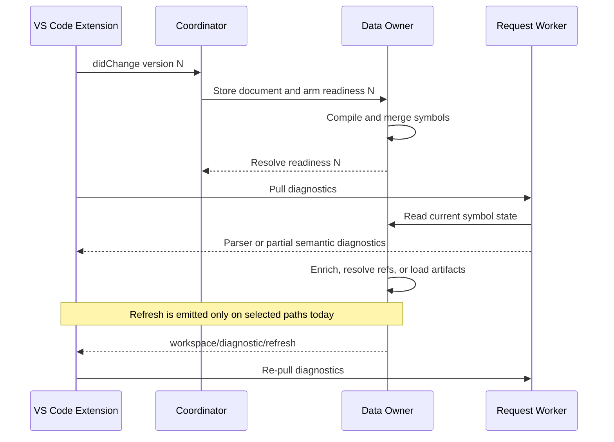
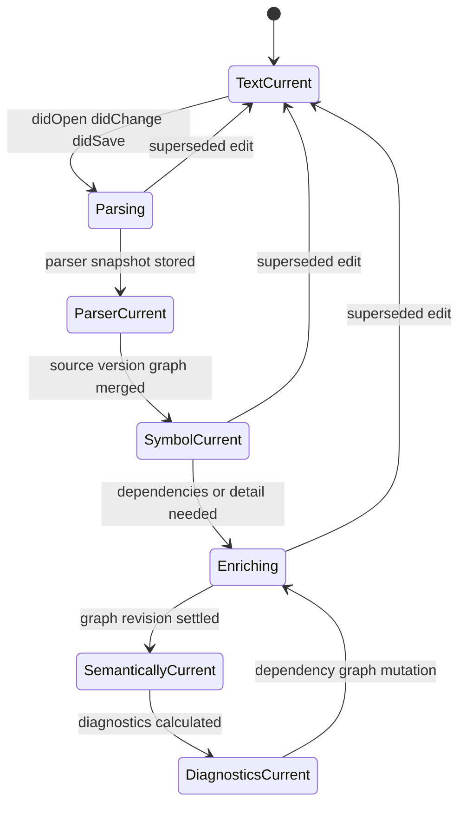

# Diagnostic Freshness and File Accuracy Assessment

## Purpose

Assess how the Apex VS Code extension can:

- keep document diagnostics accurate and low-noise as language-server state changes;
- communicate how accurate the language server's semantic understanding is for the active file.

The language server intentionally loads and enriches workspace state lazily. That is compatible with accurate diagnostics, but only if a later graph mutation reliably invalidates the diagnostic result produced from the earlier, incomplete state.

## Summary

The server already has the foundations needed for this work:

- pull diagnostics through the LSP diagnostic provider;
- per-document source-version tracking;
- data-owner readiness latches for document symbol state;
- debounced `workspace/diagnostic/refresh` support;
- asynchronous enrichment, dependency resolution, and artifact loading.

The central weakness is that symbol readiness and diagnostic freshness are separate implicit concepts. There is no authoritative state transition saying that a semantic graph mutation has invalidated diagnostics for a document. Refresh coverage therefore depends on the path that changed the graph.

The most immediate defect is that queued prerequisite enrichment creates, but does not execute, the Effect that emits `workspace/diagnostic/refresh`. Diagnostics can therefore remain preliminary after that asynchronous enrichment completes.

## Current Flow

## Findings

### 1. Queued prerequisite enrichment does not execute the refresh Effect

`LCSAdapter` reads `workspace.diagnostics.refreshSupport` during initialization and configures the refresh service with that value. The refresh service correctly refuses to send `workspace/diagnostic/refresh` unless the client advertised support. The VS Code `LanguageClient` advertises this standard capability at runtime.

Relevant implementation:

- `packages/apex-ls/src/server/LCSAdapter.ts:1698-1705`
- `packages/lsp-compliant-services/src/services/DiagnosticRefreshService.ts:94-109`

`PrerequisiteEnrichmentService` previously created the Effect returned by `signalEnrichmentComplete()` without running it. The queue now executes that Effect only when diagnostic-originated prerequisites changed semantic state; already-satisfied work remains a no-op to prevent a refresh/re-pull loop.

- `packages/lsp-compliant-services/src/services/PrerequisiteEnrichmentService.ts:39-48`
- `packages/lsp-compliant-services/src/services/DiagnosticRefreshService.ts:94-139`
- `packages/apex-lsp-vscode-extension/src/language-server.ts:195-222`

Impact before the fix: queued prerequisite enrichment could update semantic state without causing the client to re-pull diagnostics.

### 2. Initial diagnostics can intentionally be incomplete

`DiagnosticProcessingService` returns cached parser diagnostics promptly, queues prerequisite enrichment, and documents that semantic diagnostics are expected on the subsequent refresh pull.

- `packages/lsp-compliant-services/src/services/DiagnosticProcessingService.ts:320-344`
- `packages/lsp-compliant-services/src/services/DiagnosticProcessingService.ts:544-563`

This behavior is reasonable for responsiveness. The correctness requirement is that every state transition capable of changing semantic diagnostics must invalidate the earlier result and cause a later re-pull.

### 3. Refresh signaling is path-specific rather than mutation-driven

Some paths signal a refresh:

- asynchronous document-open and file-open enrichment: `packages/lsp-compliant-services/src/services/PrerequisiteOrchestrationService.ts:441-459`;
- coordinated prerequisite completion: `packages/lsp-compliant-services/src/services/PrerequisiteOrchestrationService.ts:558-565`;
- queued prerequisite enrichment: `packages/lsp-compliant-services/src/services/PrerequisiteEnrichmentService.ts:39-48`;
- background SObject enrichment: `packages/lsp-compliant-services/src/services/SObjectEnrichmentService.ts:219-237`.

However, accepted symbol-table write-backs are the general state-commit point. They update document state and resolve waiters, but do not centrally invalidate diagnostics:

- `packages/apex-ls/src/worker.platform.shared.ts:3594-3663`.

Impact: new enrichment, artifact, or deferred-reference paths can change the graph without refreshing affected diagnostics.

### 4. Cached document state cannot express semantic diagnostic freshness

`DocumentStateCache` tracks source document version, parser diagnostics, parse tree, symbol detail level, and indexing state:

- `packages/lsp-compliant-services/src/services/DocumentStateCache.ts:39-64`.

Its source-version checks are correct:

- `packages/lsp-compliant-services/src/services/DocumentStateCache.ts:91-116`.

It does not track the semantic graph revision used to calculate diagnostics, result completeness, unresolved prerequisite state, or invalidation caused by dependent graph changes.

Impact: unchanged source can retain a diagnostic result calculated from obsolete semantic state.

### 5. Readiness is deterministic in workers, but diagnostics still have a polling fallback

The data owner has per-URI, per-version readiness latches. They distinguish current, stale, timeout, and no-pending-compile outcomes:

- `packages/apex-ls/src/worker/dataOwnerQueue.ts:165-273`;
- `packages/apex-ls/src/worker.platform.shared.ts:3334-3439`.

Diagnostic processing instead polls its cache for up to 500ms when it races document open. The implementation identifies this as a candidate for event-driven replacement:

- `packages/lsp-compliant-services/src/services/DiagnosticProcessingService.ts:280-318`.

Impact: diagnostic freshness differs by execution path and worker availability. A request can produce a preliminary result when the authoritative version is about to become available.

### 6. Workspace readiness does not communicate active-file accuracy

The extension exposes only broad server states such as starting, loading, ready, stopped, and error:

- `packages/apex-lsp-vscode-extension/src/status-bar.ts:202-303`.

The server emits only a workspace-wide ingestion-complete notification:

- `packages/apex-ls/src/server/LCSAdapter.ts:1286-1298`.

The server already has finer per-file state through readiness latches, document versions, and detail levels. The extension does not receive a supported summary of that state.

Impact: a workspace-wide `Ready` state can imply more certainty than the language server has for the active document.

### 7. Some document diagnostics are analysis signals rather than correctness errors

The diagnostic processor adds graph-derived circular-dependency warnings and high-impact informational diagnostics:

- `packages/lsp-compliant-services/src/services/DiagnosticProcessingService.ts:742-803`.

These can be useful in graph analysis, but are not necessarily source-correctness diagnostics. They can make the Problems view noisy and reduce trust in diagnostics.

## Target Model

Track source freshness, semantic completeness, and diagnostic freshness independently.

`DiagnosticsCurrent` should mean all of the following:

- diagnostic source version equals the current document version;
- diagnostics were calculated against the relevant current semantic graph revision;
- no known prerequisite that can affect this document remains outstanding;
- when those conditions cannot be satisfied, the result is explicitly marked parser-only, partial, or blocked rather than represented as complete.

This model must remain parser-owned. Source text may be transported to the parser and used for ranges, but no raw-text fallback may infer symbols, dependencies, or semantic diagnostic facts.

## Recommendations

### 1. Execute the queued-enrichment refresh Effect

Run the Effect returned by `DiagnosticRefreshService.signalEnrichmentComplete()` after queued prerequisite enrichment succeeds. Keep the server guard: it is required by the LSP protocol and supports clients that do not implement refresh.

Required verification:

- regression test proves queued enrichment results in `workspace/diagnostic/refresh` after the debounce window;
- existing service tests retain guard and debounce coverage.

### 2. Introduce a semantic diagnostic invalidation service

Evolve the current refresh service from an enrichment-specific signal into a mutation-driven invalidation boundary. It should receive structured events containing at least:

- affected URI;
- document version;
- semantic graph revision or generation;
- mutation reason;
- whether the mutation can affect document diagnostics.

Centralize notification at graph commit points rather than relying on every caller to remember to signal manually.

Initial commit points:

- accepted `UpdateSymbolSubset` write-backs;
- interactive compile commits;
- successful deferred-reference draining at workspace-load completion;
- successful missing Apex artifact installation;
- successful SObject artifact installation;
- configuration changes that affect validation.

The LSP refresh request remains workspace-scoped. The service should nevertheless track affected URIs so it can suppress refreshes that cannot affect an open or previously diagnosed document.

### 3. Track diagnostic freshness in `DocumentStateCache`

Add a compact `diagnosticState` rather than treating cached parser diagnostics as a semantic result. It should record:

- source document version;
- parser diagnostic revision;
- semantic graph revision used to calculate the result;
- completeness: `parser`, `partial`, `complete`, or `blocked`;
- invalidation reason;
- outstanding prerequisite category, if any.

Only cache semantic diagnostics when source version and graph revision match current state. Reject stale background completions after an edit or a newer graph commit.

### 4. Use readiness latches for diagnostic requests

Before thorough semantic diagnostics run, use the existing deterministic `AwaitSymbolReadiness` mechanism for the requested document version.

When readiness times out or is superseded:

- return the most recent parser-owned diagnostic snapshot;
- classify the result as partial or blocked;
- rely on semantic mutation invalidation to cause a later re-pull.

Once equivalent event-driven readiness exists in local fallback mode, remove the diagnostic-specific 500ms cache polling path.

### 5. Separate correctness diagnostics from analysis output

Move high-impact symbol messages out of normal document diagnostics. Prefer the graph view or a dedicated analysis surface.

Re-evaluate circular-dependency messages similarly. Keep them in Problems only if they represent an actionable parser- or symbol-backed language problem with a precise range.

### 6. Report active-file semantic accuracy to the extension

Add a server-to-client notification, for example `apex/documentSemanticState`, for active or open Apex documents. It should report server-owned facts only:

- URI and document version;
- lifecycle stage;
- current detail level;
- currentness;
- unresolved prerequisite count and category.

Use a separate active-document language-status detail from the existing workspace ingestion state:

| Server state | Suggested status |
| --- | --- |
| Compile pending for current source | `Analyzing current version` |
| Parser complete, semantic work outstanding | `Syntax checked; semantic analysis pending` |
| Semantic graph current | `Semantically current` |
| Dependency or artifact unavailable | `Analysis incomplete: dependency loading` |
| Newer edit superseded work | `Analysis stale: newer edit pending` |

The UI must be observational. It must not infer semantic state from document text.

## Test Plan

Add end-to-end tests for the semantic state transition contract, not only unit tests for debounce behavior.

1. Initialization captures the client refresh capability and configures diagnostic refresh only when the diagnostic provider is enabled.
2. A document-open enrichment triggers one debounced refresh and returns the accurate semantic result on re-pull.
3. A re-pulled diagnostic request with already-satisfied prerequisites does not schedule another refresh.
4. A version-N enrichment completing after a version-N+1 edit is rejected and cannot make stale diagnostics current.
5. Deferred-reference draining after workspace batch ingestion invalidates diagnostics for dependent files.
6. Missing Apex and SObject artifact installation invalidates relevant diagnostics.
7. The active-editor status distinguishes workspace ingestion completion from semantic currentness for that document.
8. Graph-analysis informational signals do not appear in Problems unless explicitly enabled as diagnostics.

## Delivery Order

1. Execute the queued document-open enrichment refresh Effect and prove that diagnostic-originated queued work does not form a refresh loop.
2. Add an integration test covering one asynchronous enrichment scenario and diagnostic re-pull.
3. Centralize semantic-mutation invalidation and refresh signaling.
4. Add explicit diagnostic freshness metadata to document state.
5. Route diagnostic requests through deterministic readiness.
6. Add active-file semantic status in the extension.
7. Remove or gate non-correctness diagnostics.

The first two items validate the dropped queued-enrichment Effect and the resulting single diagnostic re-pull. The remaining work makes diagnostics and file-accuracy reporting durable as lazy loading, artifact resolution, and cross-file analysis continue to evolve.

## Worker Topology

In the worker-enabled topology, diagnostic processing runs in a request-pool worker while `prerequisiteEnrichment` is coordinator-only. The worker-local queue does not register that coordinator handler, so it cannot currently perform the queued enrichment or trigger refresh. A follow-up must dispatch prerequisite computation through a worker-aware path that reads the data-owner state, awaits an accepted version-checked write-back, and signals refresh only after that authoritative mutation. Do not solve this by registering coordinator-local enrichment or refresh state in a request-pool worker.
