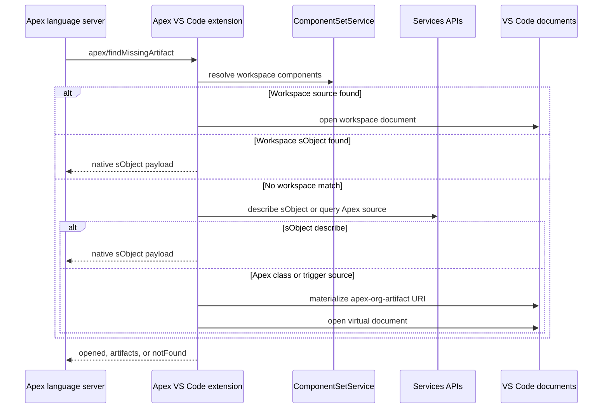
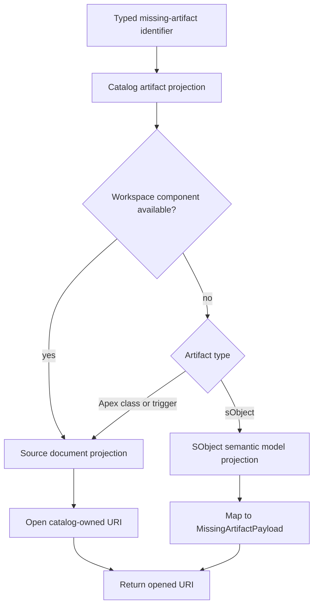

# Missing Artifact Resolution And Catalog Migration

## Scope

Discovery for moving client-side missing-artifact lookup from direct Salesforce Services APIs to `OrgMetadataCatalog`.

- Apex LS repository: `/Users/peter.hale/git/apex-ls-mywork`
- Services reference repository: `/Users/peter.hale/git/salesforcedx-vscode-ref`
- Applies to client-side handling of `apex/findMissingArtifact`

## Current Flow

The server owns semantic discovery. When parser-owned semantic resolution cannot locate a type, it sends the custom server-to-client request `apex/findMissingArtifact`. The method registry declares it as a request, server-to-client, gated by the `findMissingArtifactProvider` capability.

- Request registry: `packages/apex-lsp-shared/src/methods/ApexCustomMethods.ts:72-79`
- Request payload and outcomes: `packages/apex-lsp-shared/src/index.ts:273-292`
- Cross-file type-resolution trigger: `packages/apex-parser-ast/README.md:319-322`

In the multi-worker runtime, the enrichment worker forwards the request to the coordinator because only the coordinator owns the LSP connection. Blocking requests await the real client result, rather than treating asynchronous acceptance as completed resolution.

- Worker-to-coordinator forwarding: `packages/apex-ls/src/worker.platform.shared.ts:3224-3241`
- LSP adapter queueing, telemetry, decoding, and fallback: `packages/apex-ls/src/server/LCSAdapter.ts:1128-1163`

The VS Code extension installs a typed handler through `core.onFindMissingArtifact`, logs the request, invokes `handleFindMissingArtifact`, and returns `{ notFound: true }` if handling fails. A default responder is registered before this handler and also returns `{ notFound: true }`.

- Extension handler: `packages/apex-lsp-vscode-extension/src/language-server.ts:303-332`
- Default client responder and replacement lifecycle: `packages/apex-lsp-client/src/apexMethods.ts:244-301`
- Handler setup: `packages/apex-lsp-vscode-extension/src/missing-artifact-handler.ts:58-85`

## Current Client Resolution

`resolveMissingArtifacts` is generic client orchestration. It deduplicates typed identifiers, tries workspace resolution, then resolves remaining identifiers from the org. It merges source document URIs into `opened` and native sObject payloads into `artifacts`.

- Resolver orchestration: `packages/apex-lsp-client/src/orgArtifactResolver.ts:126-153`
- Workspace phase: `packages/apex-lsp-client/src/orgArtifactResolver.ts:180-220`
- Org phase: `packages/apex-lsp-client/src/orgArtifactResolver.ts:222-309`

### Workspace Lookup

`WorkspaceComponentSetAdapter` obtains the Services API, uses `ComponentSetService.getComponentSetFromProjectDirectories`, and searches local components for each request.

- `sobject` maps to `CustomObject`
- `apex-class` maps to `ApexClass`
- `trigger` maps to `ApexTrigger`
- Workspace class candidates incorporate parser-provided qualifiers, type references, parent context, and search hints

Sources:

- Services API call and component matching: `packages/apex-lsp-vscode-extension/src/services/workspace-component-set-adapter.ts:54-105`
- Identifier-to-metadata type mapping: `packages/apex-lsp-vscode-extension/src/services/workspace-component-set-adapter.ts:108-130`
- Candidate selection: `packages/apex-lsp-vscode-extension/src/services/workspace-component-set-adapter.ts:133-165`

For local Apex classes and triggers, the adapter returns their source URI. The resolver opens that document. For local custom objects, it parses metadata into the existing `MissingArtifactPayload` sObject describe shape.

### Org Lookup

`OrgArtifactAdapter` obtains and activates `salesforce.salesforcedx-vscode-services`, then uses its exported API. The adapter limits org lookups to 4 concurrent operations, coalesces identical requests, and caches not-found results for 3 seconds.

- Services API acquisition: `packages/apex-lsp-vscode-extension/src/services/org-artifact-adapter.ts:96-112`
- Concurrency, in-flight deduplication, and miss cache: `packages/apex-lsp-vscode-extension/src/services/org-artifact-adapter.ts:114-201`

For sObjects, the adapter invokes `MetadataDescribeService.describeCustomObject(name)`. The returned describe is adapted into a native sObject payload; it is not converted into generated Apex source.

- sObject describe: `packages/apex-lsp-vscode-extension/src/services/org-artifact-adapter.ts:204-228`
- Native-payload handling: `packages/apex-lsp-client/src/orgArtifactResolver.ts:254-275`

For classes and triggers, the adapter obtains an active-org connection from `ConnectionService.getConnection()` and executes a Tooling API query for `Id`, `Name`, `Body`, and `NamespacePrefix`. Unavailable, protected, and absent sources become typed outcomes rather than throwing into a retry loop.

- Tooling API source lookup: `packages/apex-lsp-vscode-extension/src/services/org-artifact-adapter.ts:231-276`

Resolved Apex source is written to the Apex extension-owned, read-only `apex-org-artifact:` content provider, then opened. The `.cls` and `.trigger` documents are included in language-client synchronization, so normal document-open handling carries them to the language server for parsing and compilation.

- Source materialization: `packages/apex-lsp-vscode-extension/src/services/org-artifact-fs.ts:122-136`
- Source document selectors: `packages/apex-lsp-vscode-extension/src/services/org-artifact-fs.ts:21-35`
- Client selector composition: `packages/apex-lsp-vscode-extension/src/language-server.ts:151-158`

## Catalog API Assessment

`OrgMetadataCatalog` is documented and implemented as the Services-owned inventory and content catalog for active-org and workspace metadata. Consumers query it; Services owns cache mutation and invalidation.

- Catalog ownership statement: `packages/salesforcedx-vscode-services/src/orgCatalog/orgMetadataCatalog.ts:50-54`

`resolveComponents(references)` is the appropriate replacement for separate local and org *component discovery*.

- Takes `{ type, fullName }` component references
- Resolves workspace presence and an org document URI in one operation
- Uses workspace preference when a workspace component is present
- Returns `preferredUri`, `orgUri`, and optional `workspaceUri`
- Does not require metadata inventory lookup for consumer-known references

Sources:

- Public catalog operation: `packages/salesforcedx-vscode-services/src/orgCatalog/orgMetadataCatalog.ts:94-115`
- Local/org resolution implementation: `packages/salesforcedx-vscode-services/src/orgCatalog/orgCatalogWorkspace.ts:153-188`
- Workspace-preferred and org-only behavior tests: `packages/salesforcedx-vscode-services/test/unit/orgCatalog/orgMetadataCatalog.test.ts:388-438`

For org-backed Apex classes and triggers, the catalog provides `sf-org-metadata:` URIs. The Services extension’s document provider materializes content when VS Code opens the URI. This makes the catalog the appropriate owner of source retrieval, caching, and invalidation.

- URI scheme: `packages/salesforcedx-vscode-services/src/orgCatalog/orgMetadataReference.ts:14-15`
- Document provider: `packages/salesforcedx-vscode-services/src/orgCatalog/orgMetadataDocumentProvider.ts:107-145`
- Source materialization path: `packages/salesforcedx-vscode-services/src/orgCatalog/orgCatalogDocuments.ts:27-40`

## sObject Gap

The catalog has a canonical `SObjectSemanticModel` shape containing the semantic information Apex LS needs: identity, labels, custom/queryable state, fields, relationships, and definition URIs.

- Semantic model: `packages/salesforcedx-vscode-services/src/core/artifactProjection.ts:69-117`

However, the current public `OrgMetadataCatalog` contract exposes only `getChildren`, `getEntries`, `hasTypeInventory`, and `resolveComponents`. It does not expose an operation that returns an `SObjectSemanticModel` for an object reference.

- Public catalog contract: `packages/salesforcedx-vscode-services/src/orgCatalog/orgMetadataCatalog.ts:190-195`
- Catalog entry shape: `packages/salesforcedx-vscode-services/src/orgCatalog/orgMetadataCatalogTypes.ts:70-144`

Therefore, `resolveComponents` can replace direct local and org discovery for Apex classes and triggers now, but cannot replace direct sObject describe until Services exposes a semantic projection retrieval API. `getChildren` and `getEntries` do not safely substitute for the full native sObject payload.

## Recommended Target

Expose a catalog-owned artifact projection operation, rather than adding more direct connection or describe use to Apex LS.

Desired response variants:

- `SourceDocument` for Apex classes and triggers, with the workspace URI when present or a catalog-owned `sf-org-metadata:` URI otherwise
- `SObjectSemanticModel` for sObjects
- Typed unavailable or not-found result, including protected-source where applicable

The Services package already defines projection types that fit this boundary.

- Projection types: `packages/salesforcedx-vscode-services/src/core/artifactProjection.ts:31-50`
- sObject semantic projection marker: `packages/salesforcedx-vscode-services/src/core/artifactProjection.ts:119-156`

## Migration Steps

1. Add a public catalog projection operation in Services.
2. Implement a single Apex LS catalog adapter that maps missing-artifact identifiers to catalog references:
   - `sobject` -> `CustomObject`
   - `apex-class` -> `ApexClass`
   - `trigger` -> `ApexTrigger`
3. Replace `WorkspaceComponentSetAdapter` and `OrgArtifactAdapter` in `missing-artifact-handler.ts` with that adapter.
4. For source documents, open the catalog URI directly and add `sf-org-metadata` `.cls` and `.trigger` filters to the language-client document selectors.
5. For sObjects, map `SObjectSemanticModel` to the existing wire-level `MissingArtifactPayload` at the extension boundary.
6. Remove missing-artifact-specific Tooling API queries, direct `ConnectionService` acquisition, direct `MetadataDescribeService` calls, and the `apex-org-artifact:` materialization path after catalog parity is verified.
7. Retain resolver-level response handling, capability checks, timeout behavior, and telemetry, but update telemetry fields to identify catalog projection outcomes.

## Verification Matrix

| Scenario | Expected result |
| --- | --- |
| Local Apex class | Catalog selects workspace URI; document opens and synchronizes |
| Org-only Apex class | Catalog returns `sf-org-metadata:` URI; Services provider materializes source; document opens and synchronizes |
| Local trigger | Same workspace-source path as local Apex class |
| Org-only trigger | Same catalog source-document path as org-only Apex class |
| Local custom object | Catalog returns semantic model; Apex LS receives native sObject payload |
| Org-only sObject | Catalog returns semantic model; Apex LS receives native sObject payload |
| Protected Apex source | Typed unavailable/not-found response; no retry loop |
| Missing artifact | `{ notFound: true }`; negative caching follows catalog policy |
| Active-org switch | Old catalog documents invalidate/close; subsequent resolution targets the new org |
| Services unavailable | Existing blocking warning and failure behavior remain intact |
