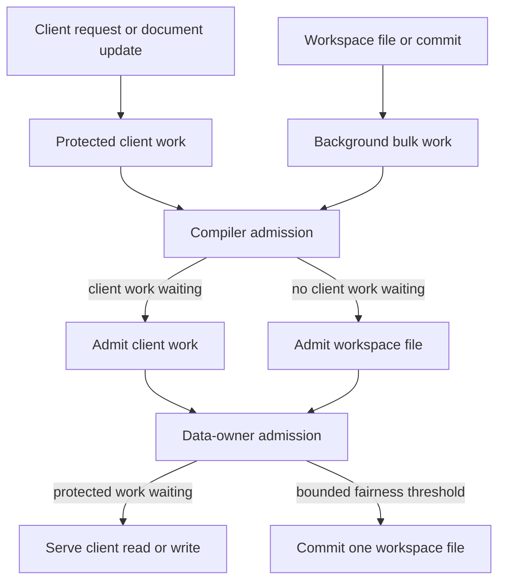

# Client-First LSP Admission Plan

Work item: W-24749107
Status: Evidence collected; scheduling changes deferred
Last updated: 2026-11-06

## Objective

Protect language-server responsiveness to client requests while a workspace load
is active. Workspace indexing must use capacity not currently required by
client-facing LSP work and yield at safe admission boundaries.

The implementation must preserve existing semantic behavior:

- Workspace compilation remains at `public-api` detail.
- Interactive document compilation remains at `private` detail.
- Request-specific enrichment remains controlled by `lspRequestPolicy`.
- No running parser/compiler operation or data-owner graph mutation is
  cancelled solely to reprioritize work.

## Client-First Invariant

Background workspace indexing must yield capacity to client-facing LSP work at
every safe admission boundary. Workspace progress is guaranteed only from
capacity not required to meet client responsiveness objectives.

"Client-facing" includes both request handlers and document lifecycle writes
that update active editor state or unblock a client request. The data owner
remains the single authoritative graph owner, and heavy compilation remains
outside its serial fiber.

## Current State

The system currently has separate scheduling domains:

| Domain | Current owner | Current behavior | Gap |
| --- | --- | --- | --- |
| LSP request admission | `LSPQueueManager` and priority scheduler | Priorities come from `lspRequestPolicy`; the scheduler has priority ordering, limits, and starvation relief. | Workspace session work does not enter this scheduler. |
| Compiler admission | `CompilationWorkerPool` | Interactive compile requests are `high`; workspace files are `low`. A released permit selects a queued high waiter first. | A running low-priority compile is non-preemptive, and a sustained high stream can starve queued low work. |
| Data-owner admission | Data-owner serial read/write queues | Pending reads drain before one write executes. | Reads protect interactivity but can indefinitely delay workspace writes. Writes do not distinguish client updates from workspace commits. |
| Workspace orchestration | `WorkspaceBatchHandler` and `WorkspaceCompilationPipeline` | Batches are ingested, compiled in bounded parallelism, and committed serially at `public-api` detail. | Its compile and commit units are independently scheduled from normal LSP admission. |

Existing safe preemption points are between workspace files and between
serialized commits. They are sufficient for the initial design; cancellation of
in-flight compilation is explicitly out of scope.

## Experiment Results

The 2026-11-06 workspace-load capture processed 648 files in seven batches in
9.292 seconds. The capture validates the tracing added before changing any
admission policy.

| Boundary | Evidence | Conclusion |
| --- | --- | --- |
| Compiler admission | 25 high-priority compiles: 1.32 ms maximum admission wait; 648 low-priority compiles: 27.51 ms maximum admission wait | Existing high-over-low permit selection is effective for this workload. Protected compiler admission is not currently justified. |
| Data-owner queue | Maximum observed queue depth: 1. Workspace commits: 21 ms maximum wait. Interactive commits: 68 ms maximum wait. | The serial queue is not materially backlogged in this capture. Additional lanes and fairness are premature. |
| Cold-read readiness | 20 ready waits totaled 1.305 s; maximum 460 ms for `codeLens`. One `diagnostics` wait returned `stale-version` after 269 ms. | Request-visible delay is dominated by waiting for a document's compile/readiness work, not by compiler permit or data-owner queue admission. |

Do not proceed with Phases 1-5 based on this capture alone. The next experiment
must deliberately issue a latency-sensitive request while all compiler permits
are occupied by workspace work. Use the existing span attributes to distinguish
compiler admission from readiness execution before revisiting client-first
scheduling.

### Readiness Trace Follow-up

The slowest `codeLens` cold-read wait was 460 ms, but its
`worker.dataOwner.AwaitSymbolReadiness` child span lasted only 5 ms. Both
interactive compiles and commits for that document had already completed before
the gate began. This excludes compiler admission, compilation, and serial queue
execution as explanations for that request's remaining approximately 455 ms.

The capture also contains lifecycle overlap for the same document version:
document open and a debounced document change each dispatched an interactive
compile. A separate diagnostics trace returned `stale-version` when its
write-back was rejected because the document was no longer present. These are
candidate lifecycle/worker-transport issues, not evidence for a bulk-work
priority policy.

The next capture now records `cold_read_gate.data_owner_dispatch_ms`,
`cold_read_gate.data_owner_handler_ms`, and
`cold_read_gate.data_owner_response_delivery_ms`. If response delivery is large,
investigate serialized-worker response posting and coordinator correlation. If
dispatch is large, investigate worker admission. If handler time is large,
investigate the readiness latch and its backing symbol-table lookup.

The follow-up transport capture showed response delivery up to 966 ms after the
worker had constructed a tiny readiness response. Worker tracing is a candidate
because its scoped OTLP layer is finalized as the request handler unwinds, before
WorkerRunner serializes and posts the response. A worker-lifetime exporter is not
currently viable because its scoped async export fibers are interrupted before
they can publish spans. Preserve live span export while testing any future
exporter-finalization change.

### Effect 4 Feasibility Follow-up

Effect 4.1.2 does not offer a drop-in remedy for this response-delivery delay.
Its worker API moved from `@effect/platform/WorkerRunner` and serialized workers
to lower-level `effect/workers` `WorkerRunner` primitives. The Node platform
adapter still starts the handler as a fiber and leaves response posting to the
protocol built above that adapter. Therefore an upgrade would require replacing
the current serialized-worker protocol rather than changing one lifecycle hook.

Effect 4 also replaces the v3 `OtlpTracer` configuration with an OpenTelemetry
provider and `@effect/opentelemetry` bridge. Its Node SDK intentionally calls
`forceFlush()` and `shutdown()` when its scoped tracer-provider layer is
released, preserving the same response-path risk if it is scoped per request.
The migration additionally requires coordinated upgrades from Effect 3.22.4 and
the `@effect/platform` 0.x packages across the workspace. Do not upgrade Effect
solely for this latency issue.

The next viable remediation experiment is a narrow, custom transport change:
post the serialized worker response before non-critical telemetry export while
retaining a worker-lifetime, explicitly shut-down exporter. It must prove both
that the response is delivered promptly and that the existing distributed
tracing integration still receives the worker spans. This is independent of the
deferred client-first scheduling work.

### Worker-Lifetime Exporter Experiment

Implemented 2026-11-06. The worker now acquires one `ManagedRuntime` for its
OTLP tracer during `WorkerInit`; all traced handler and data-owner queue Effects
reuse that runtime. The runtime is disposed after the worker runner completes,
before its explicit process exit. This removes per-request exporter scope
finalization from the serialized response path while preserving worker-local
ownership and parent-context propagation.

The real-worker regression holds the collector response for the exported
`worker.dataOwner.PingWorker` span. It first proves that the matching RPC result
returns while the export remains held, then releases the collector response and
waits for graceful topology shutdown. The regression failed before this change
with `PingWorker waited for OTLP export completion` and passes afterward.

The exporter uses a 250 ms interval so low-volume worker spans are exported
promptly without request-scoped flushes. Shutdown export remains bounded
best-effort: the Effect 3 OTLP exporter can interrupt an already in-flight HTTP
export when its scope closes, so this change does not provide durable delivery
across worker termination.

## Work Classes

Introduce a private work-class model that preserves intent across the LSP queue,
compiler permits, data-owner lanes, and workspace orchestration. Keep the public
`Priority` enum for existing scheduler ordering and API compatibility.

| Work class | Sources | Objective | Compiler admission | Data-owner admission |
| --- | --- | --- | --- | --- |
| `client-request` | Hover, completion, definition, signature help, references | Return a client response within its latency budget. | Protected/high | Protected read |
| `client-update` | Open, change, save, close | Keep active editor semantics current. | Protected/high | Protected write |
| `workspace-bulk` | Workspace ingest, `public-api` compile, symbol merge | Complete indexing without degrading clients. | Background/low | Bulk write |
| `maintenance` | Deferred enrichment and non-client work | Best-effort throughput. | Background/low | Lowest-priority lane |

The work class is internal. It must cross a worker boundary only where it is
needed to make an admission decision or attribute telemetry.

## Scheduling Policy

### Compiler permits

- A waiting `client-request` or `client-update` receives the next eligible
  released compiler permit before a queued `workspace-bulk` compile.
- A workspace compile that already holds a permit runs to completion.
- Do not enqueue more workspace work than the bounded pipeline can hold; retain
  the existing file-level admission boundary.
- Track the protected-work grant streak and the age of the oldest bulk waiter.
- After a configurable maximum protected streak or bulk-wait age, permit one
  queued bulk compile only when this does not consume reserved client capacity.

### Data-owner serial fiber

- Continue to serve client reads ahead of bulk workspace commits.
- Admit client-update writes ahead of workspace commits, especially when their
  write-back resolves a readiness latch or refreshes active-document state.
- Keep all graph mutations serial and atomic from the data owner's perspective.
- Bound client-read/client-write streaks so one waiting bulk commit eventually
  runs.
- Apply fairness between complete queue items only; never interrupt
  `addSymbolTable`, readiness-latch changes, or version validation.

### Workspace processing

- Mark workspace ingest, each per-file compile, and each symbol-table commit as
  `workspace-bulk`.
- Preserve current bounded producer parallelism, result buffering, chunking, and
  serialized commit behavior.
- Continue compiling workspace files at `public-api` detail with reference
  collection.
- Resume deferred workspace work at the next file or commit admission point.

## Implementation Plan

### Phase 1: Establish the shared contract

- Add a private `WorkClass` type next to queue contracts in
  `packages/apex-parser-ast/src/types/queue.ts`, or a focused adjacent module.
- Document the relationship between `WorkClass` and existing `Priority` values.
- Map all routed `LSPRequestType` values in
  `packages/lsp-compliant-services/src/config/lspRequestPolicy.ts` to a work
  class.
- Map workspace ingestion, compilation, and commit operations to
  `workspace-bulk`.
- Define configuration defaults for protected streak limits and maximum bulk
  wait. Defaults must favor client responsiveness.

### Phase 2: Propagate client intent from the coordinator

- Update `packages/lsp-compliant-services/src/queue/LSPQueueManager.ts` to
  derive a work class for every queued request and document notification.
- Preserve current `Priority`, timeouts, cancellation behavior, local fallback,
  and existing queue scheduling.
- Carry the work class through worker-dispatch metadata only where the compiler
  pool or data-owner queue needs it.
- Attach work class and request type to coordinator spans so downstream delays
  can be attributed to the originating client operation.

### Phase 3: Protect compiler admission

- Update `packages/apex-ls/src/compiler/CompilationWorkerPool.ts` to queue
  admission waiters by work class while retaining high/low compatibility where
  callers still provide it.
- Prefer protected client work whenever a permit becomes available.
- Preserve non-preemptive execution for running workspace compiles.
- Add bounded bulk fairness based on a protected-work streak and oldest bulk
  waiter age.
- Emit queue depth, admission wait, grant reason, work class, and permit
  utilization on compiler spans.

### Phase 4: Protect data-owner admission

- Update the serial queue implementation in
  `packages/apex-ls/src/worker.platform.shared.ts`.
- Replace the current read/write distinction with explicit protected-read,
  protected-write, workspace-bulk-write, and optional maintenance lanes.
- Preserve the data owner's one-at-a-time execution and graph ownership.
- Serve protected client reads and client-update writes before bulk commits.
- Add bounded fairness that admits one bulk commit after a configured protected
  streak or bulk-wait threshold.
- Preserve readiness-latch arm/resolve ordering, document-version checks, and
  rejected-write behavior.

### Phase 5: Classify workspace pipeline work

- Update `packages/apex-ls/src/server/WorkspaceBatchHandler.ts` to identify
  workspace ingestion and compilation as `workspace-bulk`.
- Update `packages/apex-ls/src/compiler/WorkspaceCompilationPipeline.ts` to
  preserve the class while compiling and committing each file.
- Update `WorkspaceBatchCompileOnDataOwner` in
  `packages/apex-ls/src/worker.platform.shared.ts` to submit low/background
  compiler work and bulk data-owner commits through the new contract.
- Do not change `public-api` detail, reference collection, chunk size, or
  compiler execution model in this phase.

### Phase 6: Make delay attribution actionable

- Retain and extend existing spans rather than introducing a separate logging
  system.
- Record work class, queue depth, wait duration, and fairness intervention at
  every admission boundary.
- Classify client end-to-end delay into coordinator queue, compiler admission,
  data-owner admission, and execution duration.
- Record workspace backlog, defer count, deferred duration, oldest bulk age,
  and fairness-driven bulk grants.
- Define dashboards or queries for client latency percentiles while a workspace
  load is active.

### Phase 7: Roll out incrementally

- Stage 1: Add work-class propagation and telemetry without changing scheduling
  decisions.
- Stage 2: Enable compiler client preference and compare client admission delay
  with workspace throughput.
- Stage 3: Enable data-owner lanes and bounded fairness.
- Stage 4: Tune thresholds from production-like measurements.
- Retain a configuration-backed rollback to current admission behavior while
  preserving the new telemetry.

## Regression Strategy

### Compiler admission tests

- A running low-priority workspace compile completes without interruption.
- A waiting client compile receives the next released permit before a queued
  workspace file.
- Sustained protected demand still permits bounded workspace progress.
- Cancellation of a queued request does not consume a reserved permit.
- Admission telemetry identifies normal, client-preferred, and fairness grants.

### Data-owner tests

- Client reads execute before pending workspace commits.
- Client lifecycle writes execute before pending workspace commits.
- A workspace commit eventually executes during sustained client traffic.
- FIFO ordering remains stable within each lane.
- A failed queued item does not terminate the serial queue.
- Readiness latches and stale-version rejections retain their current behavior.

### Workspace contention integration test

- Start a workspace load that occupies all compiler permits.
- Submit a client request or document update while additional workspace files
  are queued.
- Release one running workspace compile.
- Assert protected client work receives the next admission before another
  workspace file.
- Assert the client graph operation enters the data-owner lane before waiting
  workspace commits.
- Assert workspace processing resumes after client work reaches a safe boundary.
- Assert workspace symbol tables remain `public-api` and no stale/empty client
  result is produced merely because bulk work was deferred.

## Responsiveness Objectives

Finalize numeric thresholds from representative traces before enabling policy
changes. At minimum, measure the following while workspace loading is active:

- Client request end-to-end latency by request type and percentile.
- Client LSP queue delay.
- Client compiler-admission delay.
- Client data-owner-admission delay.
- Workspace backlog depth, oldest bulk wait, defer count, and total deferred
  duration.
- Workspace completion time as a tradeoff metric, not as the protected resource.

The release gate is client responsiveness: a workspace load must not cause
client requests to stall behind queued background work at an admission boundary.

## Files Expected To Change

| Area | Files |
| --- | --- |
| LSP classification | `packages/lsp-compliant-services/src/config/lspRequestPolicy.ts`, `packages/lsp-compliant-services/src/queue/LSPQueueManager.ts` |
| Shared contracts | `packages/apex-parser-ast/src/types/queue.ts`, potentially `packages/apex-parser-ast/src/queue/priority-scheduler-utils.ts` |
| Compiler permits | `packages/apex-ls/src/compiler/CompilationWorkerPool.ts` |
| Workspace pipeline | `packages/apex-ls/src/server/WorkspaceBatchHandler.ts`, `packages/apex-ls/src/compiler/WorkspaceCompilationPipeline.ts` |
| Data-owner lanes | `packages/apex-ls/src/worker.platform.shared.ts` |
| Coverage | Compiler-pool, data-owner queue, workspace pipeline, batch handler, and worker-topology test suites |

## Completion Criteria

- A waiting client request or client update is admitted ahead of queued workspace
  work at compiler and data-owner boundaries.
- Workspace compilation and graph commits remain non-preemptive after they
  begin.
- Workspace work makes bounded progress under sustained client traffic without
  consuming reserved client capacity.
- Workspace loading continues to use `public-api` semantic detail.
- Telemetry attributes client delay to coordinator queueing, compiler admission,
  data-owner admission, or execution.
- Tests prove protected admission, bounded bulk fairness, semantic-level
  preservation, readiness-latch correctness, and stale-version safety under
  contention.
