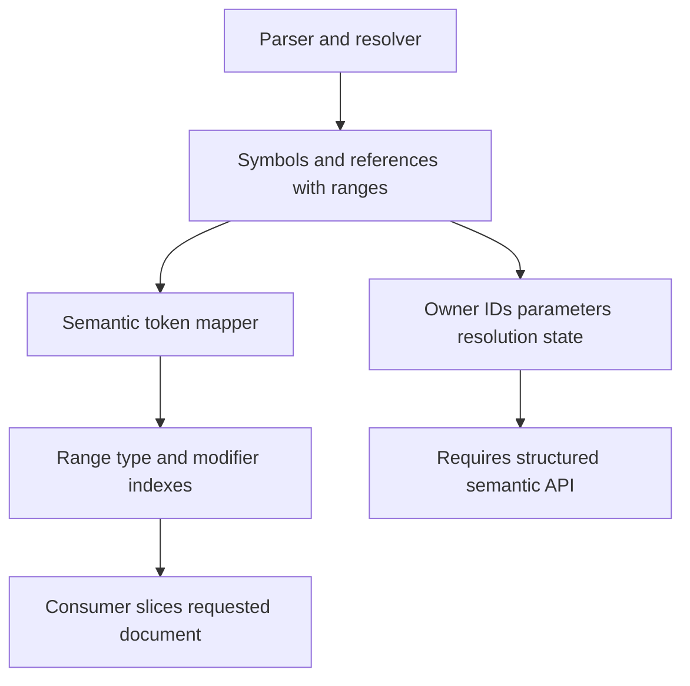
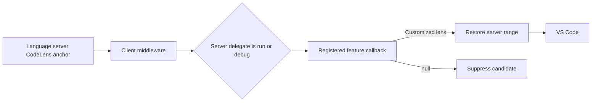
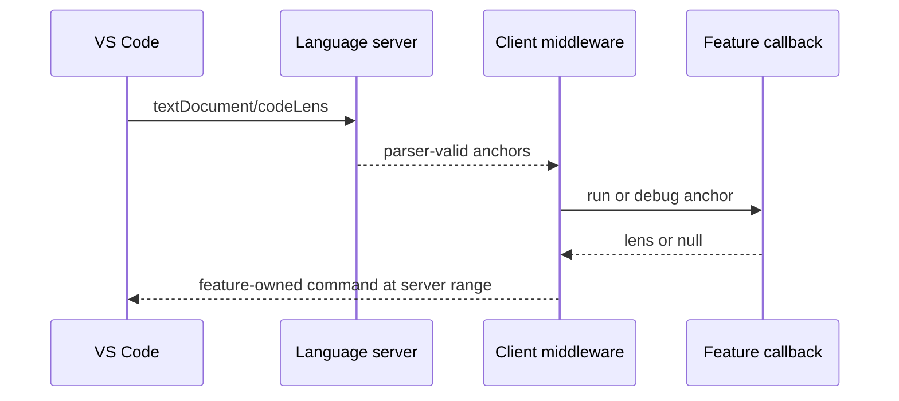
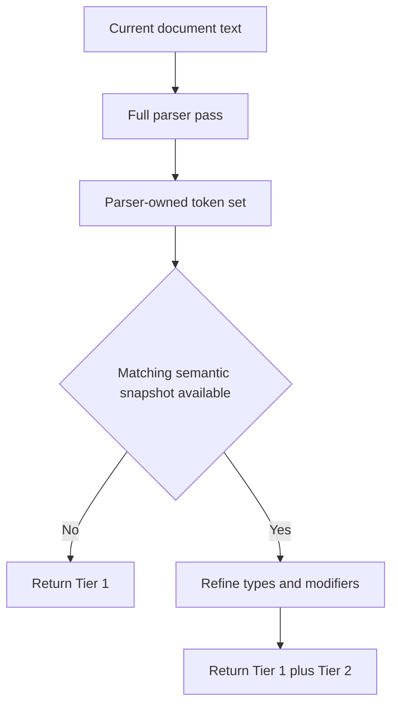

# Semantic Tokens Discovery

## Purpose

This document records discovery for a general Apex semantic-token provider.
Google's annotation-focused semantic-token proposal is useful protocol
reference material, but it is not an implementation design for this
repository. The implementation must use parser-owned and resolver-owned data,
follow the existing worker topology, and avoid source-text semantic heuristics.

The goal is broader than annotations: expose parser- and resolver-derived Apex
source spans through the standard `textDocument/semanticTokens/full` request.

## Semantic Token Protocol Boundary

A semantic-token result is a delta-compressed sequence of five integers:

```text
deltaLine, deltaStartCharacter, length, tokenTypeIndex, tokenModifierBitset
```

The result can convey a classified source range. It cannot carry arbitrary
semantic payload. In particular, it does not contain:

- Token text or a symbol name.
- Symbol IDs or resolved target IDs.
- Parent/owner relationships.
- Annotation parameter values.
- Type signatures.
- Resolution confidence or completeness.

Consumers recover text by slicing the requested document version using each
decoded range. Therefore, a consumer can identify an annotation or method name
at a location, but it cannot determine from the semantic-token response that an
annotation belongs to a particular method or class.



Semantic tokens are therefore appropriate for semantic highlighting and a
range-based document index. They are not a replacement for a structured API
when consumers need symbol identity, ownership, annotations with parameters,
or resolution provenance.

## LSP Mechanics

The normal exchange is request/response, rather than an unsolicited payload:

```text
initialize -> semanticTokensProvider legend
textDocument/semanticTokens/full -> SemanticTokens response
```

The server advertises a legend containing ordered `tokenTypes` and
`tokenModifiers`. The numerical type indexes and modifier bits in every token
refer to that legend. The legend is therefore a public compatibility contract:
changing the order changes the meaning of persisted or assumed indexes.

Use `SemanticTokensBuilder` from `vscode-languageserver` to enforce ordering
and encode relative positions. The mapper supplies absolute LSP positions and
the builder produces the compressed wire representation.

LSP positions and token lengths use UTF-16 code units unless another position
encoding is negotiated. TypeScript `string.length` is UTF-16 compatible, but
this needs explicit tests involving non-BMP characters before a token on the
same line.

Semantic tokens cannot span lines. Emit annotation heads such as
`@AuraEnabled`, not an entire annotation context that may contain multiline
arguments.

## CodeLens Ownership and Provider Model

### Decision

CodeLens is a native LSP activity, but topic-specific CodeLens policy does not
belong in the Apex language server. The language server owns parser-confirmed
anchors; the feature extension owns whether an anchor is visible and, when it
is visible, the lens title, command, arguments, and refresh conditions.

CodeLens placement is not feature-owned. A CodeLens range attaches its display
to source text; it is independent of the title length. The language server
prescribes a parser-valid anchor range and middleware preserves that exact range
when it returns a feature-produced lens.

| Concern | Owner |
| --- | --- |
| Parse Apex and identify a valid annotation/declaration anchor | Language server |
| Anchor range and source placement | Language server |
| Recognize a feature's relevant candidates | Feature extension |
| Visibility, including org-aware eligibility | Feature extension |
| Lens title, command ID, and command arguments | Feature extension |
| Test execution or debug behavior | Feature extension |
| Refresh after org, authentication, configuration, or feature state changes | Feature extension |
| Combine server anchors with a registered callback | Apex LSP VS Code extension middleware |

This boundary keeps Salesforce-org state, authentication, test framework
policy, and feature configuration out of the new language server.

### Existing Server Behavior

The existing language server still supplies `textDocument/codeLens` anchors and
classifies test and anonymous-Apex candidates in
`CodeLensProcessingService`. It produces fixed delegate commands for run/debug
test classes, run/debug test methods, and run/debug anonymous Apex.

Those server delegate commands are now **candidate descriptors**, not commands
the user clicks directly. Their command IDs and arguments tell a feature
callback what kind of operation the parser-confirmed anchor represents. The
callback can return a customized lens or `null` to suppress it.

The client maps all server run delegates to `run` and all server debug delegates
to `debug`. This intentionally creates two provider paths rather than separate
registrations for test classes, test methods, and anonymous Apex. A provider
can inspect the original server command and arguments to choose which of its
run/debug candidates to handle.

### Implemented Client-Side Registration

The public API is `ApexExtensionApi.codeLens`, backed by the host-neutral
`CodeLensCallbackRegistry<Lens>` in `apex-lsp-client`.

```ts
type CodeLensAction = 'run' | 'debug';

type CodeLensCallback<Lens> = (
  anchor: Lens,
) => Lens | null | Promise<Lens | null>;

interface CodeLensCallbackRegistry<Lens> {
  register(action: CodeLensAction, callback: CodeLensCallback<Lens>): Disposable;
  resolve(action: CodeLensAction, anchor: Lens): Promise<Lens | null>;
}
```

Registration has single-callback semantics for each action. Registering a new
`run` or `debug` callback replaces the prior callback for that action. A
registration's `Disposable` removes a callback only when it is still the
registered instance; disposing an older registration cannot remove its
replacement.

The VS Code extension creates one registry before it starts the language
client, passes that same registry to middleware for desktop and browser hosts,
and returns it to dependent extensions when activation completes. This creates
one process-wide, late-bindable integration point without adding a server-to-
client LSP request.



The middleware behavior is deliberately mechanical:

1. Preserve unresolved server lenses.
2. Map a recognized server delegate command to `run` or `debug`.
3. Give the original lens, including its delegate command/arguments and range,
   to the registered callback.
4. Suppress the lens when no callback exists, the callback returns `null`, or
   the callback fails.
5. Merge callback output while restoring the original server range.

Callback errors are logged by the VS Code host and suppress only the affected
lens. Errors from the error-reporting hook itself are also contained so a
CodeLens response cannot fail because diagnostics reporting failed.

### Test Extension Example

A test extension registers both paths. It may decide that only test-method
delegate commands are relevant, while returning `null` for other run/debug
candidate kinds.

```ts
const apex = await apexLanguageServerExtension.activate();

context.subscriptions.push(
  apex.codeLens.register('run', (anchor) =>
    anchor.command?.command === 'sf.apex.test.method.run.delegate'
      ? {
          ...anchor,
          command: {
            command: 'salesforcedx-vscode-apex.runTestMethod',
            title: 'Run Test',
            arguments: anchor.command.arguments,
          },
        }
      : null,
  ),
  apex.codeLens.register('debug', (anchor) =>
    anchor.command?.command === 'sf.apex.debug.method.run.delegate'
      ? {
          ...anchor,
          command: {
            command: 'salesforcedx-vscode-apex.debugTestMethod',
            title: 'Debug Test',
            arguments: anchor.command.arguments,
          },
        }
      : null,
  ),
);
```

The callback may also consult selected-org, authentication, feature-flag, or
test-run state before returning either lens. Those concerns remain entirely in
the test extension.

### Refresh and Document Synchronization

Document synchronization and refresh are distinct concerns.

- The current callback registry consumes the language server's native CodeLens
  anchors, so the language server remains responsible for synchronizing the
  current document to its CodeLens request path.
- A feature extension must arrange its own CodeLens refresh when its external
  state changes, such as selected org, authentication, or test availability.
- The current registry does not yet expose a feature-owned refresh event. That
  is a required follow-up if dynamic external state must immediately change
  visible lenses without a document edit or a normal editor refresh.

Semantic tokens introduce an additional freshness boundary when they become a
candidate source for a client-side producer. `SemanticTokens` responses do not
carry a document version. The consumer must capture `document.version` before
requesting tokens and discard the decoded result if that version changed before
the result is used. It must inspect only text at parser-confirmed token ranges;
it must not search document text for annotations.



### Semantic Tokens and CodeLens

Semantic tokens remain useful as a standard, generic parser-fact API. In
particular, `decorator` tokens can identify parser-confirmed annotation heads
for a consumer that owns its own candidate filtering. A consumer can decode
tokens, slice only their exact ranges from the matching document version, and
match a target annotation such as `@IsTest`.

That semantic-token path is not currently the implemented CodeLens production
path. The implemented registry receives server CodeLens anchors. If a future
topic requires annotation-only candidates that the server does not already
offer as CodeLens anchors, semantic tokens can supply those candidates, subject
to the document-version guard described above.

### Alternatives Considered

| Alternative | Decision | Reason |
| --- | --- | --- |
| Feature extension registers its own VS Code `CodeLensProvider` and consumes semantic tokens | Viable for a standalone feature | Gives full feature ownership but duplicates document-version, semantic-token decoding, and refresh mechanics in every consumer. |
| Shared client-side callback host that chooses candidates or produces lenses | Rejected | It weakens the requirement that topic owners produce their own lenses rather than sharing feature policy. |
| Language server calls feature contributors through a server-to-client custom request | Rejected | Adds a new request direction, round-trip latency, contributor lifecycle/timeout complexity, and turns the language server into a feature plugin host. |
| Declarative lens-rule registration interpreted by the language server | Rejected | Cannot express asynchronous org-aware visibility, arbitrary command arguments, or feature-specific refresh behavior without reintroducing feature policy to the server. |
| Semantic tokens replace debugger breakpoint metadata | Rejected | Semantic tokens express classified source ranges, not executable statement eligibility grouped by debugger type reference and line. The parser-owned breakpoint command remains the correct API. |

## Repository Findings

### Capability Support Exists but Is Disabled

The shared capability manager already recognizes a `semanticTokens` feature:

- `packages/apex-lsp-shared/src/capabilities/ApexCapabilitiesManager.ts`
  maps it to `semanticTokensProvider`.
- `packages/apex-lsp-shared/src/capabilities/ApexLanguageServerCapabilities.ts`
  currently sets `semanticTokensProvider` to `undefined`.
- Capability tests currently assert semantic tokens are unsupported.
- `LSP_SPAN_NAMES.TEXT_DOCUMENT_SEMANTIC_TOKENS_FULL` already exists in
  `packages/apex-lsp-shared/src/observability/tracing.browser.ts`.

Mode and platform selection should be configured through the existing
capability mechanism. The semantic-token design should not hard-code a
development-versus-production rollout policy.

### Parser and Symbol Data Already Carry Most Needed Facts

The parser creates declarations through `SymbolKind` in
`packages/apex-parser-ast/src/types/symbol.ts`:

- Classes, interfaces, triggers, methods, constructors, properties, fields,
  variables, parameters, enums, enum values, blocks, and SObjects.

Every symbol has a `SymbolLocation` containing a full `symbolRange` and an
`identifierRange`. The identifier range is the primary range for declaration
semantic tokens.

Annotations are already parser-owned:

- `Annotation` contains a name, location, and optional parameters in
  `packages/apex-parser-ast/src/types/symbol.ts`.
- `ApexSymbolCollectorListener.enterAnnotation` reads `AnnotationContext` and
  appends parser-derived annotations to the declaration being collected.
- `VisibilitySymbolListener.enterAnnotation` does the equivalent work for its
  visibility-oriented symbol path.

The existing annotation location is sufficient to derive the annotation-head
range. `symbolRange` spans the full annotation context, beginning at `@`, while
`identifierRange` spans the parser-owned annotation identifier. The semantic
token mapper can use the start of `symbolRange` and the end of
`identifierRange` to emit `@AuraEnabled` as one `decorator` token without
including arguments or inspecting source text.

Individual annotation parameters do not yet retain their own ranges. That is a
separate data-model gap only if the provider later needs to tokenize named
parameter keys and parameter values independently.

### References Carry Semantic Classification and Enrichment

`SymbolReference` in
`packages/apex-parser-ast/src/types/symbolReference.ts` includes:

- Exact source location.
- Parser context (`ReferenceContext`).
- Optional resolved symbol and type IDs.
- Read/write access mode.
- Static-access state.
- SObject state.
- Literal type and value.
- Resolution tier and completeness.
- Semantic context for member access, indexing, DML, invocation, and override
  completion.

The parser currently distinguishes method calls, class references, type
declarations, field access, constructor calls, variable usage, parameter and
generic type references, casts, `instanceof`, namespaces, return types,
properties, literals, inheritance, interface implementation, keywords, and
SOQL `FROM` types.

This provides a substantially richer source for semantic tokens than lexical
syntax coloring alone.

### Existing Current-Buffer Worker Flow Is the Right Model

`DocumentSymbol` already follows the desired path:

- The adapter receives a document request.
- `LSPQueueManager` schedules a high-priority request.
- The coordinator forwards current unsaved document content to a request-pool
  worker.
- The worker self-loads and parses the content with a full symbol collector.

Relevant implementation locations are:

- `packages/apex-ls/src/server/LCSAdapter.ts`
- `packages/lsp-compliant-services/src/queue/LSPQueueManager.ts`
- `packages/apex-ls/src/server/WorkerCoordinator.ts`
- `packages/apex-ls/src/worker.platform.shared.ts`
- `packages/apex-lsp-shared/src/workerWireSchemas.ts`
- `packages/lsp-compliant-services/src/documentSymbol/ApexDocumentSymbolProvider.ts`

Semantic tokens should use the same self-loading request-pool pattern. It
avoids waiting on or reading an older data-owner graph while an editor buffer is
changing.


## Mappable Data

### Declaration Tokens

These tokens are directly available from parser-derived declaration symbols and
do not require cross-file resolution.

| Apex construct | Parser data | Token type | Candidate modifiers |
| --- | --- | --- | --- |
| Class | `SymbolKind.Class` | `class` | `declaration`, `abstract`, `deprecated`, `defaultLibrary` |
| Interface | `SymbolKind.Interface` | `interface` | `declaration`, `deprecated`, `defaultLibrary` |
| Enum | `SymbolKind.Enum` | `enum` | `declaration`, `deprecated`, `defaultLibrary` |
| Enum value | `SymbolKind.EnumValue` | `enumMember` | `declaration`, `readonly`, `deprecated` |
| Trigger | `SymbolKind.Trigger` | `class` initially | `declaration` |
| Method | `SymbolKind.Method` | `method` | `declaration`, `static`, `abstract`, `deprecated` |
| Constructor | `SymbolKind.Constructor` | `method` or `function` | `declaration` |
| Property | `SymbolKind.Property` | `property` | `declaration`, `static`, `readonly`, `deprecated` |
| Field | `SymbolKind.Field` | `property` | `declaration`, `static`, `readonly`, `deprecated` |
| Local variable | `SymbolKind.Variable` | `variable` | `declaration`, `readonly` |
| Parameter | `SymbolKind.Parameter` | `parameter` | `declaration`, `readonly` |
| SObject | `SymbolKind.SObject` | `class` | `declaration`, `defaultLibrary` where appropriate |
| Annotation head | `Annotation` | `decorator` | None in the initial legend |

`decorator` is the appropriate standard LSP token type for an Apex annotation.
It describes an annotation's language role directly, while `macro` normally
means a preprocessor-style construct. This mapping remains parser-owned and
does not imply that Apex supports macros.

### Reference Tokens

`ReferenceContext` provides a parser-derived initial type. Resolver results can
refine the classification without preventing useful current-buffer results.

| Reference context | Initial type | Resolver refinement |
| --- | --- | --- |
| `METHOD_CALL` | `method` | Confirm callable target and modifiers |
| `CONSTRUCTOR_CALL` | `class` | Confirm constructed type kind |
| `FIELD_ACCESS` | `property` | Distinguish field/property and modifiers |
| `PROPERTY_REFERENCE` | `property` | Confirm target |
| `VARIABLE_USAGE` | `variable` | Promote to `parameter` if target is a parameter |
| `CLASS_REFERENCE` | `class` or `type` | Distinguish class, interface, and enum |
| Parameter, return, generic, cast, or `instanceof` type | `type` | Refine to type kind |
| `NAMESPACE` | `namespace` | Already parser-classified |
| `SOQL_FROM_TYPE` | `class` or `type` | Confirm SObject/type facts |
| `LITERAL` | `string`, `number`, or `keyword` | Parser already knows literal type |
| `KEYWORD_USAGE` | `keyword` | No resolution required |

### Modifiers

Only expose modifiers supported by reliable parser or resolver data.

| Modifier | Source |
| --- | --- |
| `declaration` | Declaration identifier range |
| `readonly` | `final` declarations and enum values |
| `static` | Symbol or reference static state |
| `abstract` | Class or method modifiers |
| `deprecated` | Parser-derived `@Deprecated` annotation or resolved target |
| `defaultLibrary` | Standard Apex library target |
| `modification` | Write or read/write reference access |

Visibility and Apex-specific modifiers such as `public`, `global`, `virtual`,
`override`, and `transient` should remain `keyword` spans. They should not be
invented as nonstandard semantic-token modifiers unless an explicit consumer
contract requires them.

## Coverage Tiers

The provider should not wait for cross-file resolution before returning useful
tokens. Build it in two independently useful tiers.

### Tier 1: Parser-Owned Current-Buffer Tokens

Build from a fresh full parse of the request's current content:

- Annotation heads.
- Declarations for every relevant `SymbolKind`.
- Variables and parameters.
- Method and constructor calls.
- Syntactically recognized type references.
- Keywords and declaration modifiers.
- String, numeric, boolean, and null literals.
- Namespaces and SOQL `FROM` types.

### Tier 2: Resolver-Enriched Classification

When a matching stable semantic snapshot is available, refine Tier 1 results:

- Resolve type references to classes, interfaces, or enums.
- Resolve variable uses to parameters, fields, local variables, or properties.
- Apply `defaultLibrary` to standard Apex library members and types.
- Apply `readonly` to resolved final targets.
- Apply `modification` to write/read-write references.
- Apply `deprecated` and `static` based on resolved targets.

Tier 2 must be additive. A stale or unavailable graph must not cause Tier 1
tokens to disappear or trigger a source-text fallback.



## Token Overlap and Precedence

LSP semantic tokens cannot overlap. The mapper needs one explicit precedence
policy before broad coverage is implemented.

For example:

```apex
public static final Account account = new Account();
```

The result should emit distinct, non-overlapping spans:

- `public`, `static`, and `final` as `keyword`.
- Each `Account` as `class` or `type`.
- `account` as `property` or `variable`.
- `new` as `keyword`.

Do not emit a second overlapping `defaultLibrary` token. Instead, emit `class`
with the `defaultLibrary` modifier. Similarly, emit only the annotation head as
`decorator`, leaving argument literals and keywords available for their own
non-overlapping classifications.

The provider must sort spans by position and apply deterministic collision
resolution before pushing them to `SemanticTokensBuilder`.

## Candidate Initial Legend

The exact legend must be agreed with consumers before it is advertised. This
candidate uses standard token types, including `decorator` for annotations:

```ts
const tokenTypes = [
  'namespace',
  'class',
  'interface',
  'enum',
  'enumMember',
  'type',
  'parameter',
  'variable',
  'property',
  'method',
  'decorator',
  'keyword',
  'string',
  'number',
];

const tokenModifiers = [
  'declaration',
  'readonly',
  'static',
  'abstract',
  'deprecated',
  'modification',
  'defaultLibrary',
];
```

`decorator` should be the default contract. If the Google consumer has already
implemented a hard `macro` expectation, resolve that compatibility requirement
before advertising the server legend; type names and indexes are protocol
contract. Do not add both token types for the same source span because semantic
tokens cannot overlap. A custom token type should be introduced only when a
controlled client requires it; custom types reduce interoperability with
generic LSP clients.

## Implementation Direction

Implement a general semantic-token provider, with annotations as the first
validated case rather than as the feature boundary. The existing CodeLens
callback registry is independent of semantic-token implementation; it currently
consumes existing language-server CodeLens anchors. Semantic tokens become the
generic candidate source when a future topic needs parser-confirmed annotation
anchors that the CodeLens server endpoint does not already provide.

1. Derive the parser-owned annotation-head range from `Annotation.location`
   (`symbolRange` start through `identifierRange` end), and emit it as
   `decorator`.
2. Add a semantic-token mapper/service in `lsp-compliant-services`, parallel
   to the document-symbol provider.
3. Map Tier 1 declarations, annotations, keywords, literals, and parser
   references into non-overlapping spans.
4. Add `semanticTokens` to queue request types, the worker-wire schema,
   coordinator dispatch, and the request-pool worker handler. Carry live text
   using the same pattern as `DispatchDocumentSymbol`.
5. Register the standard `textDocument/semanticTokens/full` handler and
   advertise the legend through the existing capability configuration.
6. Add Tier 2 resolver enrichment only after Tier 1 is correct and stable.

## Required Tests

### Parser and Mapper Tests

- Class, method, property, field, parameter, local-variable, enum, and enum
  member declarations.
- Class and method annotations.
- Multiple annotations on one declaration.
- Multiline annotation arguments: only the annotation head is emitted.
- Method, constructor, field/property, variable, namespace, type, literal,
  keyword, and SOQL `FROM` spans.
- Incomplete syntax during editing: return parser evidence only and never
  fabricate a token from raw text.
- Nested declarations as supported by the collector.
- Non-BMP Unicode before tokens on a line, CRLF input, and multiple tokens on
  one line.
- No overlapping spans and deterministic precedence.

### Protocol, Worker, and Capability Tests

- The advertised legend and `full` support match the mapper indexes.
- Decoding a builder result returns the expected absolute position, length,
  type, and modifiers.
- The request-pool handler receives unsaved current text.
- An immediate request after an open/change returns current-buffer tokens,
  independent of an older data-owner snapshot.
- Disabled capability behavior is safe and does not expose an unregistered
  feature.
- The semantic-token request is traced using
  `TEXT_DOCUMENT_SEMANTIC_TOKENS_FULL`.

### CodeLens Provider Tests

- A `run` callback and a `debug` callback can coexist and receive their
  respective server delegate lenses.
- A single callback selectively suppresses unrelated class, method, or
  anonymous-Apex candidates by returning `null`.
- Registering a new callback for one action replaces its predecessor.
- Disposing a stale registration does not remove its replacement.
- Callback failure and failure while reporting that error suppress only the
  affected lens.
- Middleware preserves the original server range when a callback replaces the
  title, command, or arguments.
- Middleware suppresses recognized delegates when no matching callback is
  registered, but preserves unresolved server lenses.
- The same registry instance is injected into desktop and browser language
  client middleware before startup and remains available through
  `ApexExtensionApi.codeLens` after activation.

## Open Decisions

1. Does the Google consumer require a legacy `macro` token type and legend
   index for annotations, or can it consume the standard `decorator` type?
2. Which standard token types and modifiers does each intended client support?
3. Is Tier 2 resolver enrichment required in the initial delivery, or can it
   follow a parser-only Tier 1 release?
4. If a consumer needs annotation ownership, parameters, symbol IDs, or
   resolved identities, should the server define a separate structured request
   rather than overload semantic tokens?
5. What refresh event should a future `CodeLensCallbackRegistry` expose so a
   topic extension can request immediate re-evaluation after org state changes?
